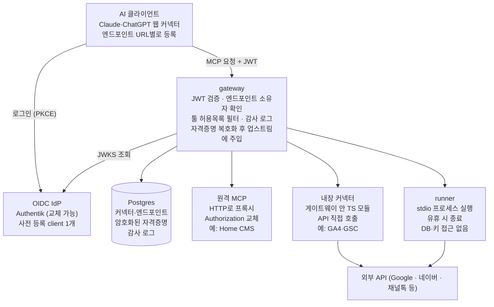

# MCP 커넥터 게이트웨이 요구사항 명세 v0.1

2026-11-04 · Steve lee

## 개요

Claude·ChatGPT 같은 AI 서비스가 웹 UI의 커스텀 커넥터(OAuth)로 붙을 수 있도록, 토큰 방식 MCP·로컬(stdio) MCP·외부 API를 중개하는 셀프호스트 게이트웨이를 만든다. 커넥터마다 URL을 따로 발급해 에이전트가 필요한 커넥터만 붙이게 하고, 과도한 MCP 컨텍스트 주입을 막는다.

- **배경**: Daniworks Home CMS의 `apps/mcp-gateway`(DEV-352)가 Authentik JWT를 검증한 뒤 Strapi MCP로 프록시하는 방식으로 Claude에서 동작 중이다. 이 구조를 여러 커넥터·여러 사용자로 일반화한다.
- **사용 단계**: 1단계 다니웍스 내부용 → 2단계 고객사 설치형(단일 테넌트, 고객사당 1설치)

## 확정 사항

게이트웨이는 자체 인가 서버를 두지 않고 OIDC IdP가 발급한 토큰을 검증하는 리소스 서버로 시작한다. stdio는 관리자 카탈로그형으로 v1에 포함한다.

| 항목               | 결정                                                                                                    |
| ------------------ | ------------------------------------------------------------------------------------------------------- |
| 언어               | TypeScript (MCP 공식 TS SDK)                                                                            |
| 배포               | Docker Compose 셀프호스트, 단일 테넌트                                                                  |
| 사용자 인증        | OIDC IdP에 위임 (1차 Authentik), 게이트웨이는 JWT 검증만                                                |
| AI 클라이언트 등록 | IdP에 사전 등록한 client 1개를 모든 엔드포인트가 공유 (A안). 사용자가 커넥터 고급 설정에 client_id 입력 |
| 엔드포인트 분리    | 경로 기준 `/c/{endpointId}/mcp`, 엔드포인트마다 노출 툴 선택                                            |
| 커넥터 범위        | 전역-공유, 전역-템플릿, 개인 3가지                                                                      |
| 커넥터 런타임      | remote(원격 MCP 프록시), builtin(게이트웨이 내장), stdio 3종 모두 v1                                    |
| stdio 실행         | 별도 runner 컨테이너에서 요청 시 실행, 유휴 시 종료. 관리자만 등록                                      |

## 시스템 구성

AI 클라이언트는 게이트웨이에만 붙고, 게이트웨이가 런타임별로 업스트림을 호출한다. 서비스는 gateway·runner·Postgres 3개다.

1. 사용자가 AI 클라이언트에 엔드포인트 URL과 client_id를 등록하면, 클라이언트가 IdP 로그인으로 JWT를 받는다.
2. MCP 요청마다 게이트웨이가 JWT와 엔드포인트 소유자를 확인하고, 허용된 툴만 통과시킨다.
3. 게이트웨이가 자격증명을 복호화해 런타임에 넘긴다. remote는 헤더, 내장 커넥터는 함수 인자, stdio는 runner가 띄우는 프로세스의 환경변수로 전달한다.

## 도메인 모델

커넥터는 업스트림을 정의하고, 자격증명은 커넥터에 범위별로 붙으며, 엔드포인트는 사용자가 커넥터 하나를 골라 툴을 추려 만든 URL이다.

| 엔티티     | 설명                                                                    | 주요 필드                                                                                                             |
| ---------- | ----------------------------------------------------------------------- | --------------------------------------------------------------------------------------------------------------------- |
| User       | OIDC `sub` 기준, 첫 로그인 시 자동 생성. 관리자 계정을 따로 두지 않는다 | sub, email, groups(로그인마다 갱신), role(user / admin, groups로 판정)                                                |
| Connector  | 업스트림 정의. owner가 없으면 전역, 있으면 개인                         | runtime, 실행 정보(URL / builtin 키 / 패키지@버전+명령), 업스트림 인증 방식, 자격증명 스키마, 공개 그룹, 툴 목록 캐시 |
| Credential | 커넥터에 붙는 암호화된 값                                               | connector, scope(global / user), userId, 값(암호문), 업스트림 OAuth면 refresh token·만료                              |
| Endpoint   | 사용자 소유의 URL 하나                                                  | owner, connector, 노출 툴 허용목록, 이름, 활성 여부                                                                   |
| AuditLog   | 툴 호출 기록                                                            | 시각, user, endpoint, 툴 이름, 결과, 소요시간                                                                         |

커넥터 범위는 별도 필드가 아니라 owner와 자격증명 스키마의 scope로 정해진다.

- **전역-공유**: owner 없음, 모든 자격증명 필드가 global. 관리자가 값까지 입력 (예: CMS 읽기 토큰)
- **전역-템플릿**: owner 없음, user 필드가 하나 이상. 사용자가 본인 값 입력 (예: 개인 구글 계정 GA)
- **개인**: owner = 사용자. runtime은 remote·builtin만 허용, stdio 불가

## 기능 요구사항

### 인증·인가

| ID        | 요구사항                                                                                                                                        |
| --------- | ----------------------------------------------------------------------------------------------------------------------------------------------- |
| F-AUTH-01 | IdP는 OIDC discovery URL·client_id·secret 환경변수로 설정한다. Authentik 전용 코드를 두지 않는다                                                |
| F-AUTH-02 | 관리 UI 로그인은 authorization code + PKCE, 세션 쿠키                                                                                           |
| F-AUTH-03 | MCP 요청은 Bearer JWT의 서명·iss·aud·exp를 검증한다. 실패 시 401과 `WWW-Authenticate: Bearer resource_metadata=…` 반환                          |
| F-AUTH-04 | 엔드포인트마다 보호 리소스 메타데이터 `/.well-known/oauth-protected-resource/c/{id}/mcp`를 발행하고 authorization_servers에 IdP issuer를 넣는다 |
| F-AUTH-05 | 토큰의 sub가 엔드포인트 소유자와 같아야 통과한다. 다른 사람의 URL로는 호출할 수 없다                                                            |
| F-AUTH-06 | groups 클레임으로 로그인 허용·관리자·전역 커넥터 공개 범위를 판정한다. 클레임 이름은 설정값                                                     |

### 커넥터

| ID       | 요구사항                                                                                                                                            |
| -------- | --------------------------------------------------------------------------------------------------------------------------------------------------- |
| F-CON-01 | 관리자는 전역 커넥터(remote / builtin / stdio)를 만들고 공개 그룹을 지정한다                                                                        |
| F-CON-02 | 자격증명 스키마를 필드 단위로 정의한다: 키, 라벨, secret 여부, scope(global / user)                                                                 |
| F-CON-03 | 업스트림 인증 방식: 없음 / 정적 토큰(헤더 이름 지정) / 환경변수(stdio) / 업스트림 OAuth2(관리자가 OAuth 클라이언트와 scope 등록) / 서비스 계정 JSON |
| F-CON-04 | 사용자는 볼 수 있는 전역 커넥터에 본인 자격증명을 입력·교체·삭제한다. 업스트림 OAuth는 "연결" 버튼으로 동의하고 refresh token으로 자동 갱신한다     |
| F-CON-05 | 사용자는 원격 MCP URL과 정적 토큰으로 개인 커넥터를 등록할 수 있다                                                                                  |
| F-CON-06 | 연결 테스트로 `tools/list`를 호출해 성공 여부를 표시하고 툴 목록(이름·설명·annotations)을 캐시한다                                                  |
| F-CON-07 | 커넥터 정의를 YAML 매니페스트로 가져오고 내보낸다                                                                                                   |

### 엔드포인트

| ID      | 요구사항                                                                                  |
| ------- | ----------------------------------------------------------------------------------------- |
| F-EP-01 | 사용자는 커넥터 하나로 엔드포인트를 여러 개 만들 수 있고, 각각 URL `/c/{id}/mcp`를 받는다 |
| F-EP-02 | 노출 툴 허용목록을 지정한다. `tools/list` 응답을 거르고 목록 밖 `tools/call`은 거부한다   |
| F-EP-03 | annotations의 readOnlyHint 기준으로 "읽기 전용만" 일괄 선택을 제공한다                    |
| F-EP-04 | 비활성화·삭제하면 다음 요청부터 바로 거부한다                                             |
| F-EP-05 | 연결 안내 화면에 URL, client_id, callback 값, Claude·ChatGPT 등록 절차를 보여준다         |

### 런타임

| ID       | 요구사항                                                                                                                                                         |
| -------- | ---------------------------------------------------------------------------------------------------------------------------------------------------------------- |
| F-RUN-01 | remote: Streamable HTTP 프록시. 헤더 화이트리스트, Authorization 교체, redirect 거부, SSE 무버퍼 전달, abort 전파 (DEV-352 동작 계승)                            |
| F-RUN-02 | builtin: 게이트웨이 안의 TS 모듈. 툴 정의·호출·자격증명 주입을 공통 인터페이스로 구현한다                                                                        |
| F-RUN-03 | stdio: 게이트웨이가 runner에 실행을 요청하고 세션을 중계한다. 프로세스 키는 (커넥터, 자격증명 소유자)이며 같은 사용자의 여러 엔드포인트가 한 프로세스를 공유한다 |
| F-RUN-04 | 유휴 타임아웃(기본 10분)에 종료하고, 동시 프로세스 상한을 넘으면 가장 오래 쉰 프로세스부터 종료한다                                                              |
| F-RUN-05 | 패키지는 커넥터 등록 시 고정 버전으로 runner 볼륨에 설치한다. 실행 시 다운로드하지 않는다. npm·PyPI 지원                                                         |
| F-RUN-06 | stdio 프로세스는 빈 환경에서 시작해 매니페스트에 선언된 키만 받는다                                                                                              |
| F-RUN-07 | 업스트림 오류는 MCP 오류로 정리해 반환하고 자격증명·원문 예외를 노출하지 않는다                                                                                  |

### 관리 UI

| ID      | 요구사항                                                                                            |
| ------- | --------------------------------------------------------------------------------------------------- |
| F-UI-01 | 사용자 화면: 내 엔드포인트, 내 자격증명, 연결 안내                                                  |
| F-UI-02 | 관리자 화면: 커넥터 카탈로그, 사용자 목록, 실행 중 stdio 프로세스, 감사 로그                        |
| F-UI-03 | 감사 로그는 시각·사용자·엔드포인트·툴 이름·결과·소요시간만 남긴다. 인자·응답 본문은 저장하지 않는다 |

## 비기능 요구사항

| 구분      | 요구사항                                                                                            |
| --------- | --------------------------------------------------------------------------------------------------- |
| 비밀 보호 | 자격증명은 AES-256-GCM으로 암호화, 키는 환경변수. 이전 키를 병행 지정해 무중단 회전                 |
| 로그      | 토큰·자격증명·요청/응답 본문·원문 예외를 기록하지 않는다                                            |
| 격리      | runner는 DB·암호화 키에 접근하지 않는다. stdio 프로세스는 커넥터별 디렉터리와 별도 OS 사용자로 실행 |
| 배포      | Compose 3서비스(gateway, runner, postgres). TLS·도메인은 외부 리버스 프록시 담당, SSE 버퍼링 해제   |
| 설정      | 모든 설정은 환경변수와 관리 UI. 다니웍스 고정값을 코드에 넣지 않는다                                |
| 호환      | Claude.ai 커스텀 커넥터, ChatGPT Developer mode, Claude Code. MCP Streamable HTTP                   |
| 운영      | `/health` 제공, 기동 시 DB 마이그레이션 자동 실행. 백업 대상은 Postgres와 암호화 키                 |
| 이식성    | IdP는 표준 OIDC만 가정해 Keycloak·Google Workspace 등으로 교체 가능                                 |

## v1 커넥터 후보

세 가지 런타임을 각각 하나 이상 실제 커넥터로 검증하는 순서로 잡는다. 공식 원격 OAuth MCP가 이미 있는 서비스(Notion, Linear, Sentry, Airtable, Meta 등)는 대상에서 뺀다.

| 순위 | 커넥터                              | 런타임  | 업스트림 인증           | 비고                                                                                      |
| ---- | ----------------------------------- | ------- | ----------------------- | ----------------------------------------------------------------------------------------- |
| P0   | Daniworks Home CMS                  | remote  | 정적 토큰               | 기존 DEV-352 게이트웨이를 대체                                                            |
| P0   | Google Analytics 4 + Search Console | builtin | 업스트림 OAuth (Google) | 구글 공식 GA MCP는 로컬 실행 전용                                                         |
| P1   | 네이버 검색광고                     | stdio   | 환경변수 (API 키 3종)   | 커뮤니티 [naver-ads-mcp](https://glama.ai/mcp/servers/2duckchun/naver-ads-mcp), 조회 전용 |
| P2   | 네이버 검색                         | stdio   | 환경변수                | 공식 MCP 없음. 새 키는 NAVER API HUB 발급 ([정리](https://wikidocs.net/461908))           |
| P2   | 채널톡                              | builtin | 정적 토큰               | 문의·상담 데이터. Open API 범위 확인 필요                                                 |

## 범위 밖과 v2 과제

| 항목                                                                 | 넣는 시점                  |
| -------------------------------------------------------------------- | -------------------------- |
| 자체 인가 서버(CIMD·DCR 지원). 사용자가 URL만 붙여넣으면 연결되는 UX | 고객사 설치 전             |
| stdio 커넥터의 컨테이너 단위 격리                                    | 고객사 설치 전             |
| 사용자가 직접 stdio 커넥터 등록                                      | 격리 완료 후 검토          |
| 범용 OpenAPI 커넥터 (스펙 + 토큰으로 툴 자동 생성)                   | v2                         |
| 툴 설명 덮어쓰기, 여러 커넥터의 툴을 묶은 엔드포인트                 | v2                         |
| 사용자별 호출 한도·과금                                              | 필요 시                    |
| 멀티 테넌시                                                          | 계획 없음 (고객사당 1설치) |

## 미결 사항

- [ ] IdP client 유형: Public(PKCE, secret 없음)으로 Claude·ChatGPT 양쪽이 붙는지 확인. 안 되면 Confidential client의 secret을 모든 사용자에게 보여줘야 하는 문제를 정리
- [ ] 토큰 audience: 현행처럼 client_id 고정 유지할지, resource URL 기준으로 갈지
- [ ] 업스트림 OAuth 갱신 실패(구글 테스트 앱은 7일 만료 등) 시 사용자에게 재연결을 알리는 방식
- [ ] 관리 UI 구성: 게이트웨이와 같은 서버에서 렌더링할지, 별도 SPA로 둘지
- [ ] 규모 목표: 내부용 기준 동시 사용자·동시 stdio 프로세스 상한 기본값
- [ ] 프로젝트 이름과 레포 위치 (`daniworks-home` 모노레포 안 / 별도 레포)

## 출처

- `HJ-company/daniworks-home` — `apps/mcp-gateway`, `docs/operations/mcp-gateway.md` (DEV-352)
- [authentik Dynamic Client Registration](https://docs.goauthentik.io/add-secure-apps/providers/oauth2/dynamic-client-registration) — 등록 요청에 Bearer 토큰 필요
- [Zuplo: claude.ai 커넥터 호환표](https://zuplo.com/learn/mcp/compatibility/clients/claude-connectors) — DCR·CIMD·사전 등록 client·resource 지원
- [OpenAI: ChatGPT Developer mode](https://developers.openai.com/api/docs/guides/developer-mode.md) — CIMD·DCR 지원
- [mcp-latchkey](https://glama.ai/mcp/servers/robot-apocalypse/mcp-latchkey), [ai-pipes/mcp-registry](https://glama.ai/mcp/servers/l5x3lr7dc9) — 유사 오픈소스 구조 참고
