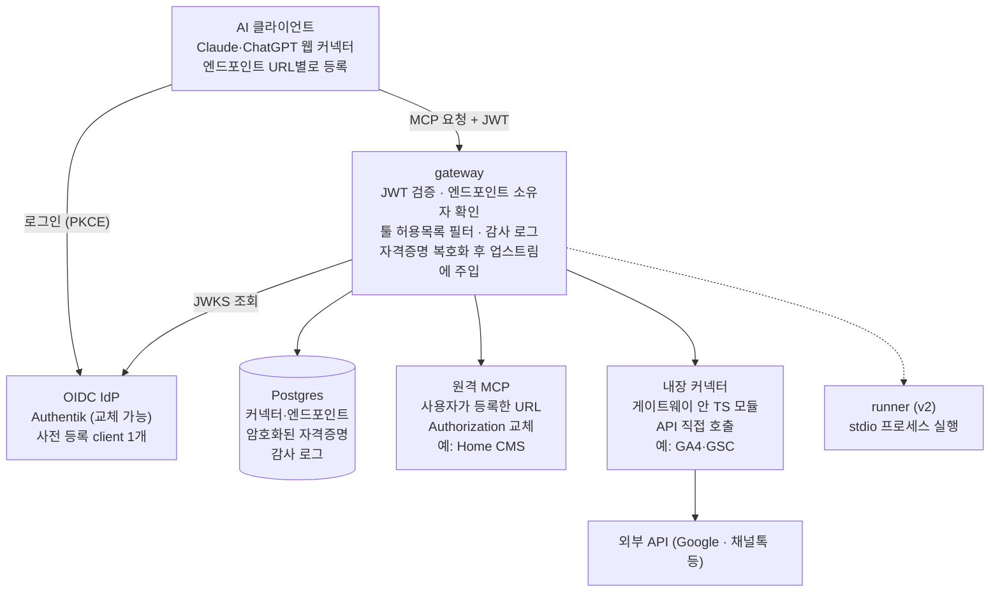

# MCP 커넥터 게이트웨이 요구사항 명세 v0.2

2026-11-04 · Steve lee

v0.2 변경: v1의 중심을 관리자 전역 커넥터에서 사용자 개인 커넥터로 옮겼다. 전역 커넥터와 stdio 런타임은 v2로 미룬다. 데이터 구조는 v2를 위해 그대로 둔다.

## 개요

Claude·ChatGPT 같은 AI 서비스가 웹 UI의 커스텀 커넥터(OAuth)로 붙을 수 있도록, 토큰 방식 MCP·외부 API를 중개하는 셀프호스트 게이트웨이를 만든다. 사용자는 자기 MCP 서버나 외부 서비스를 직접 등록하고, 필요한 툴만 추린 URL을 받아 에이전트에 붙인다. 과도한 MCP 컨텍스트 주입을 막고, 업스트림 토큰을 AI 클라이언트에 넘기지 않는다.

- **배경**: Daniworks Home CMS의 `apps/mcp-gateway`(DEV-352)가 Authentik JWT를 검증한 뒤 Strapi MCP로 프록시하는 방식으로 Claude에서 동작 중이다. 이 구조를 여러 커넥터·여러 사용자로 일반화한다.
- **사용 단계**: 1단계 다니웍스 내부용 → 2단계 고객사 설치형(단일 테넌트, 고객사당 1설치)

## 확정 사항

게이트웨이는 자체 인가 서버를 두지 않고 OIDC IdP가 발급한 토큰을 검증하는 리소스 서버로 시작한다.

| 항목                | 결정                                                                                                          |
| ------------------- | ------------------------------------------------------------------------------------------------------------- |
| 언어                | TypeScript (MCP 공식 TS SDK)                                                                                  |
| 배포                | Docker Compose 셀프호스트, 단일 테넌트                                                                        |
| 사용자 인증         | OIDC IdP에 위임 (1차 Authentik), 게이트웨이는 JWT 검증만                                                      |
| AI 클라이언트 등록  | IdP에 사전 등록한 client 1개를 모든 엔드포인트가 공유 (A안). 사용자가 커넥터 고급 설정에 client_id 입력       |
| 엔드포인트 분리     | 경로 기준 `/c/{endpointId}/mcp`, 엔드포인트마다 노출 툴 선택                                                  |
| 커넥터 범위         | v1은 사용자 개인 커넥터. 관리자 전역 커넥터(공유·템플릿)는 v2                                                 |
| 커넥터 런타임       | v1은 remote(원격 MCP 프록시)와 builtin(게이트웨이 내장). stdio는 v2                                           |
| 커넥터와 엔드포인트 | 사용자는 한 흐름에서 커넥터 등록과 첫 엔드포인트 생성을 함께 한다. 같은 커넥터로 엔드포인트를 더 만들 수 있다 |

## 시스템 구성

AI 클라이언트는 게이트웨이에만 붙고, 게이트웨이가 런타임별로 업스트림을 호출한다. v1 서비스는 gateway·Postgres 2개다. runner는 stdio를 넣는 v2부터 배포한다.

1. 사용자가 관리 UI에서 원격 MCP 서버나 내장 서비스를 등록하고, 노출할 툴을 골라 엔드포인트 URL을 받는다.
2. 사용자가 AI 클라이언트에 엔드포인트 URL과 client_id를 등록하면, 클라이언트가 IdP 로그인으로 JWT를 받는다.
3. MCP 요청마다 게이트웨이가 JWT와 엔드포인트 소유자를 확인하고, 허용된 툴만 통과시킨다.
4. 게이트웨이가 사용자의 자격증명을 복호화해 런타임에 넘긴다. remote는 헤더, 내장 커넥터는 함수 인자로 전달한다.

## 도메인 모델

커넥터는 업스트림 하나와 그 접속 정보다. 자격증명은 커넥터에 붙고, 엔드포인트는 커넥터 하나에서 툴을 추려 만든 URL이다.

| 엔티티      | 설명                                                                    | 주요 필드                                                                                                                                                                  |
| ----------- | ----------------------------------------------------------------------- | -------------------------------------------------------------------------------------------------------------------------------------------------------------------------- |
| User        | OIDC `sub` 기준, 첫 로그인 시 자동 생성. 관리자 계정을 따로 두지 않는다 | sub, email, groups(로그인마다 갱신), role(user / admin, groups로 판정)                                                                                                     |
| Connector   | 업스트림 정의. v1은 모두 owner가 있는 개인 커넥터                       | owner, runtime, 실행 정보(URL / builtin 키), 업스트림 인증 방식, 자격증명 스키마, 툴 목록 캐시, 상태(연결 중·정상·오류·재연결 필요), 관리자 사용 중지 여부, 최근 호출 시각 |
| Credential  | 커넥터에 붙는 암호화된 값                                               | connector, scope, userId, 값(암호문), 업스트림 OAuth면 refresh token·만료                                                                                                  |
| Endpoint    | 사용자 소유의 URL 하나                                                  | owner, connector, 노출 툴 허용목록, 저장 시점 툴 목록(knownTools), 이름, 활성 여부, 최근 호출 시각                                                                         |
| AuditLog    | 툴 호출 기록                                                            | 시각, user, endpoint, connector, 툴 이름, 결과, 소요시간                                                                                                                   |
| ActivityLog | 사람이 한 작업 기록(툴 호출 제외)                                       | 시각, 행위자, 작업(커넥터 사용 중지·재사용, Client Secret 보기 등), 대상 종류·ID, 사유                                                                                     |

- v1의 커넥터와 자격증명은 모두 사용자 본인 것이다. 자격증명 scope는 `user`만 쓴다.
- 전역 커넥터를 위한 구조(커넥터 owner 비움, 자격증명 scope `global`, 공개 그룹)는 DB와 매니페스트에 남겨 두고 v1 화면·API에서는 쓰지 않는다.
- 개인 커넥터의 runtime은 remote·builtin만 허용한다(DB 제약 `personal_connector_runtime`).

## 기능 요구사항

### 인증·인가

| ID        | 요구사항                                                                                                                                                                                            |
| --------- | --------------------------------------------------------------------------------------------------------------------------------------------------------------------------------------------------- |
| F-AUTH-01 | IdP는 OIDC discovery URL·client_id·secret 환경변수로 설정한다. 로그인·토큰 검증에는 Authentik 전용 코드를 두지 않는다                                                                               |
| F-AUTH-02 | 관리 UI 로그인은 authorization code + PKCE, 세션 쿠키                                                                                                                                               |
| F-AUTH-03 | MCP 요청은 Bearer JWT의 서명·iss·aud·exp를 검증한다. 실패 시 401과 `WWW-Authenticate: Bearer resource_metadata=…` 반환                                                                              |
| F-AUTH-04 | 엔드포인트마다 보호 리소스 메타데이터 `/.well-known/oauth-protected-resource/c/{id}/mcp`를 발행하고 authorization_servers에 IdP issuer를 넣는다                                                     |
| F-AUTH-05 | 토큰의 sub가 엔드포인트 소유자와 같아야 통과한다. 다른 사람의 URL로는 호출할 수 없다                                                                                                                |
| F-AUTH-06 | groups 클레임으로 로그인 허용·관리자를 판정한다. 클레임 이름은 설정값. 관리 UI 로그인뿐 아니라 MCP 요청마다 토큰의 groups로 로그인 허용 그룹을 다시 확인하고, 이때 사용자의 email·groups를 갱신한다 |
| F-AUTH-07 | (v2) 전역 커넥터의 공개 그룹 후보는 그룹 디렉터리 어댑터를 거친다. 기본 어댑터는 로그인한 사용자의 groups를 모으고, IdP 관리 API를 쓰는 어댑터(1차 Authentik)는 설정으로 켠다                       |

### 커넥터

| ID       | 요구사항                                                                                                                                                                                           |
| -------- | -------------------------------------------------------------------------------------------------------------------------------------------------------------------------------------------------- |
| F-CON-01 | 사용자는 원격 MCP 서버를 개인 커넥터로 등록한다: URL, 업스트림 인증(없음 / 정적 토큰 + 헤더 이름·접두어)                                                                                           |
| F-CON-02 | 사용자는 내장 커넥터(builtin)를 골라 개인 커넥터로 등록한다. 필요한 자격증명 항목은 내장 커넥터가 정의한다                                                                                         |
| F-CON-03 | 내장 커넥터의 업스트림 인증 방식: 정적 토큰 / 업스트림 OAuth2 / 서비스 계정 JSON. OAuth2는 사용자가 자기 OAuth 앱의 client id·secret을 입력하고 "연결"로 동의한다. refresh token으로 자동 갱신한다 |
| F-CON-04 | 사용자는 자기 커넥터의 접속 정보와 자격증명을 교체·재연결·삭제한다. 커넥터를 지우면 그 커넥터의 엔드포인트도 함께 지운다                                                                           |
| F-CON-05 | 등록할 때 연결 테스트로 `tools/list`를 호출해 성공해야 저장한다. 툴 목록(이름·설명·annotations)을 캐시하고, 사용자가 다시 테스트해 갱신할 수 있다                                                  |
| F-CON-06 | 사용자가 입력한 원격 URL은 https만 받고, DNS 해석 결과가 사설·loopback·link-local·메타데이터 주소면 거부한다. 연결할 때마다 다시 확인하고 redirect는 따르지 않는다                                 |
| F-CON-07 | (v2) 관리자는 전역 커넥터(remote / builtin / stdio)를 만들고 공개 그룹을 지정한다. 자격증명 필드 scope(global / user)와 YAML 매니페스트 가져오기·내보내기를 지원한다                               |

### 엔드포인트

| ID      | 요구사항                                                                                  |
| ------- | ----------------------------------------------------------------------------------------- |
| F-EP-01 | 사용자는 커넥터 하나로 엔드포인트를 여러 개 만들 수 있고, 각각 URL `/c/{id}/mcp`를 받는다 |
| F-EP-02 | 노출 툴 허용목록을 지정한다. `tools/list` 응답을 거르고 목록 밖 `tools/call`은 거부한다   |
| F-EP-03 | annotations의 readOnlyHint 기준으로 "읽기 전용만" 일괄 선택을 제공한다                    |
| F-EP-04 | 비활성화·삭제하면 다음 요청부터 바로 거부한다                                             |
| F-EP-05 | 연결 안내 화면에 URL, client_id, client secret, Claude·ChatGPT 등록 절차를 보여준다       |

### 런타임

| ID       | 요구사항                                                                                                                                            |
| -------- | --------------------------------------------------------------------------------------------------------------------------------------------------- |
| F-RUN-01 | remote: Streamable HTTP 프록시. 헤더 화이트리스트, Authorization 교체, redirect 거부, SSE 무버퍼 전달, abort 전파 (DEV-352 동작 계승)               |
| F-RUN-02 | builtin: 게이트웨이 안의 TS 모듈. 툴 정의·호출·자격증명 항목·자격증명 주입을 공통 인터페이스로 구현한다                                             |
| F-RUN-03 | 업스트림 오류는 MCP 오류로 정리해 반환하고 자격증명·원문 예외를 노출하지 않는다. 업스트림 OAuth 갱신이 실패하면 재연결 안내와 관리 UI 링크를 넣는다 |
| F-RUN-04 | (v2) stdio: 게이트웨이가 runner에 실행을 요청하고 세션을 중계한다. 유휴 타임아웃·동시 프로세스 상한, 고정 버전 설치, 빈 환경에서 선언된 키만 전달   |

### 관리 UI

| ID      | 요구사항                                                                                                                                                                                                              |
| ------- | --------------------------------------------------------------------------------------------------------------------------------------------------------------------------------------------------------------------- |
| F-UI-01 | 사용자 화면: 엔드포인트 목록, 엔드포인트 추가, 엔드포인트 상세(커넥터 설정, 최근 호출 20건 포함), 연결 안내                                                                                                           |
| F-UI-02 | 관리자 화면: 사용자 목록, 감사 로그. 사용자 목록에서 사용자별 커넥터(이름·종류·원격 URL·최근 호출)를 보고 사용 중지할 수 있다. 자격증명 값은 관리자에게도 보이지 않는다. (v2) 커넥터 카탈로그, 실행 중 stdio 프로세스 |
| F-UI-03 | 감사 로그는 시각·사용자·엔드포인트·커넥터·툴 이름·결과·소요시간만 남긴다. 인자·응답 본문은 저장하지 않는다. 관리자 작업과 Client Secret 보기는 감사 로그와 따로 작업 기록(ActivityLog)에 남긴다                       |

## 비기능 요구사항

| 구분      | 요구사항                                                                                                                                                                                                                                 |
| --------- | ---------------------------------------------------------------------------------------------------------------------------------------------------------------------------------------------------------------------------------------- |
| 비밀 보호 | 자격증명은 AES-256-GCM으로 암호화, 키는 환경변수. 이전 키를 병행 지정해 무중단 회전                                                                                                                                                      |
| 로그      | 토큰·자격증명·요청/응답 본문·원문 예외를 기록하지 않는다                                                                                                                                                                                 |
| 네트워크  | 사용자 입력 URL로 내부망에 접근하지 못하게 한다(F-CON-06). 허용 예외 대역은 관리자 환경변수로만 지정한다                                                                                                                                 |
| 격리      | (v2) runner는 DB·암호화 키에 접근하지 않는다. stdio 프로세스는 커넥터별 디렉터리와 별도 OS 사용자로 실행                                                                                                                                 |
| 배포      | v1은 Compose 2서비스(gateway, postgres), v2에서 runner 추가. TLS·도메인은 외부 리버스 프록시 담당, SSE 버퍼링 해제                                                                                                                       |
| 설정      | 모든 설정은 환경변수와 관리 UI. 다니웍스 고정값을 코드에 넣지 않는다                                                                                                                                                                     |
| 호환      | Claude.ai 커스텀 커넥터, ChatGPT Developer mode, Claude Code. MCP Streamable HTTP                                                                                                                                                        |
| 운영      | `/health` 제공, 기동 시 DB 마이그레이션 자동 실행. 백업 대상은 Postgres와 암호화 키. 감사 로그는 기본 90일(`AUDIT_RETENTION_DAYS`, 0이면 무기한), 작업 기록은 기본 365일(`ACTIVITY_RETENTION_DAYS`) 보관하고 기동 시와 하루 한 번 지운다 |
| 이식성    | IdP는 표준 OIDC만 가정해 Keycloak·Google Workspace 등으로 교체 가능                                                                                                                                                                      |

## v1 커넥터 후보

v1 런타임 두 가지를 각각 실제 커넥터로 검증한다. 모두 사용자가 직접 등록한다. 공식 원격 OAuth MCP가 이미 있는 서비스(Notion, Linear, Sentry, Airtable, Meta 등)는 대상에서 뺀다.

| 순위 | 커넥터                              | 런타임  | 업스트림 인증                                  | 비고                                                                                                                                    |
| ---- | ----------------------------------- | ------- | ---------------------------------------------- | --------------------------------------------------------------------------------------------------------------------------------------- |
| P0   | Daniworks Home CMS                  | remote  | 정적 토큰                                      | 사용자가 CMS MCP URL과 토큰을 등록. 기존 DEV-352 게이트웨이를 대체                                                                      |
| P0   | Google Analytics 4 + Search Console | builtin | 업스트림 OAuth (사용자 OAuth 앱) / 서비스 계정 | 구글 공식 GA MCP는 로컬 실행 전용. 외부(External) 테스트 앱은 refresh token이 7일에 만료되므로 서비스 계정이나 Workspace 내부 앱을 안내 |
| P2   | 채널톡                              | builtin | 정적 토큰                                      | 문의·상담 데이터. Open API 범위 확인 필요                                                                                               |
| v2   | 네이버 검색광고                     | stdio   | 환경변수 (API 키 3종)                          | 커뮤니티 [naver-ads-mcp](https://glama.ai/mcp/servers/2duckchun/naver-ads-mcp), 조회 전용                                               |
| v2   | 네이버 검색                         | stdio   | 환경변수                                       | 공식 MCP 없음. 새 키는 NAVER API HUB 발급 ([정리](https://wikidocs.net/461908))                                                         |

## 범위 밖과 v2 과제

| 항목                                                                         | 넣는 시점                  |
| ---------------------------------------------------------------------------- | -------------------------- |
| 관리자 전역 커넥터(공유·템플릿), 공개 그룹, 커넥터 카탈로그, YAML 매니페스트 | v2                         |
| stdio 런타임과 runner 서비스(관리자 등록)                                    | v2                         |
| stdio 커넥터의 컨테이너 단위 격리                                            | 고객사 설치 전             |
| 사용자가 직접 stdio 커넥터 등록                                              | 격리 완료 후 검토          |
| 자체 인가 서버(CIMD·DCR 지원). 사용자가 URL만 붙여넣으면 연결되는 UX         | 고객사 설치 전             |
| 원격 MCP의 업스트림 OAuth(사용자가 붙이는 원격 서버가 OAuth를 요구하는 경우) | v2                         |
| 사람이 로그인하지 않는 에이전트(n8n·봇)용 호출 방식                          | v2                         |
| 범용 OpenAPI 커넥터 (스펙 + 토큰으로 툴 자동 생성)                           | v2                         |
| 툴 설명 덮어쓰기, 여러 커넥터의 툴을 묶은 엔드포인트                         | v2                         |
| 사용자별 호출 한도·과금                                                      | 필요 시                    |
| 멀티 테넌시                                                                  | 계획 없음 (고객사당 1설치) |

## 미결 사항

- [x] IdP client 유형: Confidential client를 유지하고 secret을 사용자에게 공유한다. 보기 기록과 회전 절차를 둔다 (2026-11-04)
- [ ] 토큰 audience: 현행처럼 client_id 고정 유지할지, resource URL 기준으로 갈지
- [x] 업스트림 OAuth 갱신 실패: MCP 오류 응답에 재연결 안내와 링크를 넣고, 관리 UI에 상태를 표시한다. 외부 알림 채널은 두지 않는다 (2026-11-04)
- [x] 관리 UI 구성: 별도 SPA(`apps/web`)를 gateway가 같은 출처 `/admin`에서 서빙한다
- [ ] 규모 목표: 내부용 기준 동시 사용자·사용자당 커넥터 수 상한 기본값
- [x] 프로젝트 이름과 레포 위치: `mcp-outlet` 별도 레포
- [x] v1 커넥터 범위: 사용자 개인 커넥터 중심, 전역 커넥터·stdio는 v2 (2026-11-04)
- [x] 화면 용어: 화면에서도 엔드포인트·커넥터·자격증명을 그대로 쓴다 (2026-11-04)
- [x] 관리자의 사용자 커넥터 확인: 사용자 목록에서 사용자별 커넥터를 보고 사용 중지할 수 있다 (2026-11-04)
- [x] 기록과 보관: 관리자 작업·secret 보기는 별도 작업 기록, 그룹에서 빠진 사용자는 MCP 요청에서도 거부, 감사 로그 90일·작업 기록 365일 기본 보관, 감사 로그에 connector 저장, 사용자는 엔드포인트 상세에서 최근 호출 20건 확인 (2026-11-04)

## 출처

- `HJ-company/daniworks-home` — `apps/mcp-gateway`, `docs/operations/mcp-gateway.md` (DEV-352)
- [authentik Dynamic Client Registration](https://docs.goauthentik.io/add-secure-apps/providers/oauth2/dynamic-client-registration) — 등록 요청에 Bearer 토큰 필요
- [Zuplo: claude.ai 커넥터 호환표](https://zuplo.com/learn/mcp/compatibility/clients/claude-connectors) — DCR·CIMD·사전 등록 client·resource 지원
- [OpenAI: ChatGPT Developer mode](https://developers.openai.com/api/docs/guides/developer-mode.md) — CIMD·DCR 지원
- [mcp-latchkey](https://glama.ai/mcp/servers/robot-apocalypse/mcp-latchkey), [ai-pipes/mcp-registry](https://glama.ai/mcp/servers/l5x3lr7dc9) — 유사 오픈소스 구조 참고
