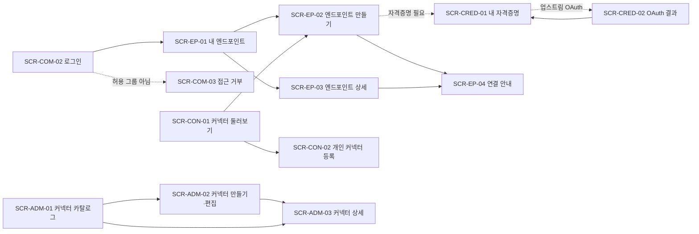

# 화면 정의 목록

관리 UI(`apps/web`)에 필요한 화면 목록이다. 요구사항은 [PRD](../PRD.md)의 ID로 연결한다. 화면 ID에 링크가 있는 화면은 상세 정의가 있다. 나머지는 이 폴더에 `{화면 ID}.md`로 추가한다.

## 전제

- 관리 UI는 gateway가 같은 출처의 `/admin`에서 서빙하는 SPA다. 화면 경로는 모두 `/admin/` 아래에 둔다. `/auth/*`(로그인·콜백), `/api/*`(관리 API), `/c/*`(MCP)는 gateway 경로라 화면 경로로 쓰지 않는다.
- 계정은 하나다. 관리자용 계정이나 별도 로그인을 두지 않고, 같은 IdP 계정에 역할(role)만 `user`와 `admin`으로 나눈다. 역할은 Authentik(IdP)의 그룹으로 정하고, MCP Outlet 화면에서는 바꾸지 않는다(F-AUTH-06).
  - **user**: `OIDC_LOGIN_GROUPS`에 속한 사람. 비어 있으면 IdP 로그인에 성공한 모든 사람
  - **admin**: user 조건을 만족하면서 `OIDC_ADMIN_GROUPS`에도 속한 사람. 내 작업 화면을 그대로 쓰고, 관리 메뉴가 추가로 보인다
  - 역할은 로그인할 때마다 groups 클레임으로 다시 정한다. Authentik에서 그룹을 바꾸면 다음 로그인부터 반영된다.
- 아래 화면 묶음은 메뉴 구분이다. 묶음마다 다른 계정을 쓰는 것이 아니다.
- 비밀값(토큰·secret)은 입력만 받고 다시 보여주지 않는다. 화면에는 "설정됨"과 마지막 변경 시각만 표시한다.

## 화면 목록

우선순위는 첫 실사용 목표(Daniworks Home CMS remote 커넥터를 Claude에 연결) 기준이다.

- **P0**: 첫 실사용에 꼭 필요
- **P1**: v1 범위
- **P2**: v1 후반

### 공통 (역할 무관)

| ID                          | 화면           | 경로               | 주요 내용                                                             | 요구사항   | 우선순위 |
| --------------------------- | -------------- | ------------------ | --------------------------------------------------------------------- | ---------- | -------- |
| [SCR-COM-01](SCR-COM-01.md) | 레이아웃       | (모든 화면)        | 메뉴(관리 메뉴는 admin만), 이메일·역할, 로그아웃                      | F-UI-01·02 | P0       |
| [SCR-COM-02](SCR-COM-02.md) | 로그인 시작    | `/admin/login`     | IdP로 로그인 버튼. 세션이 없으면 모든 화면이 여기로 보냄              | F-AUTH-02  | P0       |
| [SCR-COM-03](SCR-COM-03.md) | 접근 거부      | `/admin/forbidden` | 로그인은 됐지만 허용 그룹이 아님. user가 관리 화면에 들어온 경우 포함 | F-AUTH-06  | P0       |
| SCR-COM-04                  | 오류·없는 화면 | `/admin/*`         | 404, 세션 만료, 서버 오류. 원문 예외는 보여주지 않음                  | F-RUN-07   | P1       |

### 내 작업 (user·admin)

| ID                        | 화면                  | 경로                           | 주요 내용                                                                                                 | 요구사항          | 우선순위 |
| ------------------------- | --------------------- | ------------------------------ | --------------------------------------------------------------------------------------------------------- | ----------------- | -------- |
| [SCR-EP-01](SCR-EP-01.md) | 내 엔드포인트 목록    | `/admin/` (홈)                 | 이름, 커넥터, 노출 툴 수, 활성 여부, URL 복사. 비어 있으면 첫 엔드포인트 만들기 안내                      | F-EP-01, F-UI-01  | P0       |
| [SCR-EP-02](SCR-EP-02.md) | 엔드포인트 만들기     | `/admin/endpoints/new`         | 커넥터 선택 → 노출 툴 선택("읽기 전용만" 일괄 선택) → 이름. 자격증명이 없는 커넥터면 먼저 입력하도록 안내 | F-EP-01·02·03     | P0       |
| [SCR-EP-03](SCR-EP-03.md) | 엔드포인트 상세·편집  | `/admin/endpoints/:id`         | 노출 툴 허용목록 수정, 이름 변경, 활성·비활성, 삭제(확인 필요). 커넥터 툴 목록이 바뀌었으면 새 툴을 표시  | F-EP-02·03·04     | P0       |
| [SCR-EP-04](SCR-EP-04.md) | 연결 안내             | `/admin/endpoints/:id/connect` | 엔드포인트 URL, client_id, client secret, Claude·ChatGPT·Claude Code 등록 절차를 탭으로                   | F-EP-05           | P0       |
| SCR-CON-01                | 커넥터 둘러보기       | `/admin/connectors`            | 내가 볼 수 있는 전역 커넥터와 내 개인 커넥터. 런타임, 설명, 내 자격증명 상태(필요·설정됨·재연결 필요)     | F-CON-01·04       | P1       |
| SCR-CRED-01               | 내 자격증명           | `/admin/credentials`           | 커넥터별 user 필드 입력·교체·삭제. 업스트림 OAuth는 "연결" 버튼과 연결 상태·만료 시각                     | F-CON-04, F-UI-01 | P1       |
| SCR-CRED-02               | 업스트림 OAuth 결과   | `/admin/credentials/callback`  | Google 등 업스트림 동의 후 돌아오는 화면. 성공·실패를 보여주고 내 자격증명으로 돌아감                     | F-CON-04          | P1       |
| SCR-CON-02                | 개인 커넥터 등록·편집 | `/admin/connectors/new`        | 원격 MCP URL, 정적 토큰, 헤더 이름. 저장 전 연결 테스트로 툴 목록 확인                                    | F-CON-05·06       | P2       |

### 관리 (admin)

| ID                          | 화면               | 경로                                | 주요 내용                                                                                                                                                 | 요구사항              | 우선순위 |
| --------------------------- | ------------------ | ----------------------------------- | --------------------------------------------------------------------------------------------------------------------------------------------------------- | --------------------- | -------- |
| [SCR-ADM-01](SCR-ADM-01.md) | 커넥터 카탈로그    | `/admin/manage/connectors`          | 전역 커넥터 목록. 런타임, 공개 그룹, 범위(공유·템플릿), 마지막 연결 테스트 결과, 엔드포인트 수                                                            | F-CON-01, F-UI-02     | P0       |
| [SCR-ADM-02](SCR-ADM-02.md) | 커넥터 만들기·편집 | `/admin/manage/connectors/:id/edit` | 런타임 선택, 실행 정보(URL / builtin 키 / 패키지·버전·명령), 업스트림 인증 방식, 자격증명 스키마(키·라벨·secret·scope), 공개 그룹. YAML 가져오기·내보내기 | F-CON-01·02·03·07     | P0       |
| [SCR-ADM-03](SCR-ADM-03.md) | 커넥터 상세        | `/admin/manage/connectors/:id`      | 전역(global) 자격증명 값 입력, 연결 테스트와 캐시된 툴 목록, stdio면 설치 상태·설치 로그 요약                                                             | F-CON-02·06, F-RUN-05 | P0       |
| SCR-ADM-04                  | 사용자 목록        | `/admin/manage/users`               | 이메일, 그룹, 역할, 마지막 로그인, 엔드포인트 수. 그룹·역할은 IdP가 정하므로 읽기 전용                                                                    | F-UI-02               | P1       |
| SCR-ADM-05                  | stdio 프로세스     | `/admin/manage/processes`           | 실행 중 프로세스: 커넥터, 자격증명 소유자, 시작·마지막 사용 시각, 유휴 시간. 강제 종료                                                                    | F-RUN-03·04, F-UI-02  | P1       |
| SCR-ADM-06                  | 감사 로그          | `/admin/manage/audit`               | 시각, 사용자, 엔드포인트, 툴 이름, 결과, 소요시간. 기간·사용자·엔드포인트·결과 필터. 인자·응답 본문은 없음                                                | F-UI-02·03            | P1       |

## 화면 흐름

## 정할 것

- **client secret 표시**: Confidential client라 연결 안내(SCR-EP-04)에 secret을 보여줘야 한다. 모든 사용자에게 같은 secret이 보이는 문제는 PRD 미결 사항과 같이 정한다.
- **커넥터 둘러보기 분리 여부**: 커넥터 둘러보기(SCR-CON-01)와 내 자격증명(SCR-CRED-01)은 다루는 대상이 같다. 커넥터 카드 안에서 자격증명을 입력하는 한 화면으로 합칠 수 있다.
- **재연결 알림**: 업스트림 OAuth 갱신 실패를 어디에 띄울지 정해야 한다(PRD 미결 사항). 후보는 홈 배너, 레이아웃(SCR-COM-01) 배지, 엔드포인트 목록의 상태 표시다.
- ~~**커넥터 삭제 처리**~~: 삭제 확인 창에 영향받는 엔드포인트·사용자 수를 보여주기로 했다([SCR-ADM-03](SCR-ADM-03.md#삭제)).
