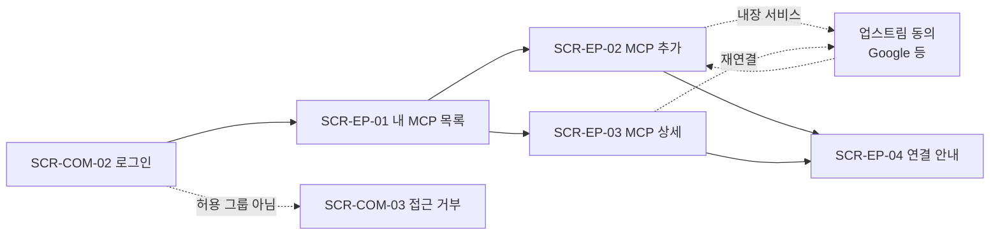

# 화면 정의 목록

관리 UI(`apps/web`)에 필요한 화면 목록이다. 요구사항은 [PRD](../PRD.md)의 ID로 연결한다. 화면 ID에 링크가 있는 화면은 상세 정의가 있다. 나머지는 이 폴더에 `{화면 ID}.md`로 추가한다.

## 전제

- 관리 UI는 gateway가 같은 출처의 `/admin`에서 서빙하는 SPA다. 화면 경로는 모두 `/admin/` 아래에 둔다. `/auth/*`(로그인·콜백), `/api/*`(관리 API), `/c/*`(MCP)는 gateway 경로라 화면 경로로 쓰지 않는다.
- 계정은 하나다. 관리자용 계정이나 별도 로그인을 두지 않고, 같은 IdP 계정에 역할(role)만 `user`와 `admin`으로 나눈다. 역할은 Authentik(IdP)의 그룹으로 정하고, MCP Outlet 화면에서는 바꾸지 않는다(F-AUTH-06).
  - **user**: `OIDC_LOGIN_GROUPS`에 속한 사람. 비어 있으면 IdP 로그인에 성공한 모든 사람
  - **admin**: user 조건을 만족하면서 `OIDC_ADMIN_GROUPS`에도 속한 사람. 내 작업 화면을 그대로 쓰고, 관리 메뉴가 추가로 보인다
  - 역할은 로그인할 때마다 groups 클레임으로 다시 정한다. Authentik에서 그룹을 바꾸면 다음 로그인부터 반영된다.
- 아래 화면 묶음은 메뉴 구분이다. 묶음마다 다른 계정을 쓰는 것이 아니다.
- v1은 사용자가 자기 MCP 서버를 직접 등록한다(PRD v0.2). 관리자가 준비하는 전역 커넥터와 stdio는 v2다.
- 비밀값(토큰·secret)은 입력만 받고 다시 보여주지 않는다. 화면에는 "설정됨"과 마지막 변경 시각만 표시한다.

## 용어

사용자 화면에서는 개발 용어 대신 아래 말을 쓴다. 코드·API·이 문서의 다른 부분은 오른쪽 용어를 그대로 쓴다.

| 화면에 쓰는 말 | 개발 용어    | 뜻                                                        |
| -------------- | ------------ | --------------------------------------------------------- |
| 내 MCP         | endpoint     | AI 에이전트에 붙이는 URL 하나. 서버 하나 + 허용한 툴 목록 |
| MCP 주소       | endpoint URL | `/c/{id}/mcp` 전체 주소                                   |
| 서버           | connector    | 내가 등록한 원격 MCP 서버나 내장 서비스와 그 접속 정보    |
| 접속 정보      | credential   | 서버에 붙을 때 쓰는 토큰·계정 연결                        |

## 화면 목록

우선순위는 첫 실사용 목표(사용자가 Daniworks Home CMS를 직접 등록해 Claude에 연결) 기준이다.

- **P0**: 첫 실사용에 꼭 필요
- **P1**: v1 범위
- **v2**: 다음 버전. 정의는 남겨 두되 v1에서 만들지 않는다

### 공통 (역할 무관)

| ID                          | 화면           | 경로               | 주요 내용                                                             | 요구사항   | 우선순위 |
| --------------------------- | -------------- | ------------------ | --------------------------------------------------------------------- | ---------- | -------- |
| [SCR-COM-01](SCR-COM-01.md) | 레이아웃       | (모든 화면)        | 메뉴(관리 메뉴는 admin만), 이메일·역할, 로그아웃                      | F-UI-01·02 | P0       |
| [SCR-COM-02](SCR-COM-02.md) | 로그인 시작    | `/admin/login`     | IdP로 로그인 버튼. 세션이 없으면 모든 화면이 여기로 보냄              | F-AUTH-02  | P0       |
| [SCR-COM-03](SCR-COM-03.md) | 접근 거부      | `/admin/forbidden` | 로그인은 됐지만 허용 그룹이 아님. user가 관리 화면에 들어온 경우 포함 | F-AUTH-06  | P0       |
| SCR-COM-04                  | 오류·없는 화면 | `/admin/*`         | 404, 세션 만료, 서버 오류. 원문 예외는 보여주지 않음                  | F-RUN-03   | P1       |

### 내 작업 (user·admin)

| ID                        | 화면        | 경로                           | 주요 내용                                                                                                  | 요구사항                            | 우선순위 |
| ------------------------- | ----------- | ------------------------------ | ---------------------------------------------------------------------------------------------------------- | ----------------------------------- | -------- |
| [SCR-EP-01](SCR-EP-01.md) | 내 MCP 목록 | `/admin/` (홈)                 | 이름, 서버, 노출 툴 수, 상태, MCP 주소 복사. 비어 있으면 첫 MCP 추가 안내                                  | F-EP-01, F-UI-01                    | P0       |
| [SCR-EP-02](SCR-EP-02.md) | MCP 추가    | `/admin/endpoints/new`         | 서버 등록(새 서버 또는 내 기존 서버) → 연결 테스트 → 툴 선택 → 이름. 내장 서비스는 계정 연결을 흐름 안에서 | F-CON-01·02·03·05·06, F-EP-01·02·03 | P0       |
| [SCR-EP-03](SCR-EP-03.md) | MCP 상세    | `/admin/endpoints/:id`         | 툴 허용목록, 이름, 활성·비활성, 삭제. 서버 접속 정보 교체·재연결·다시 테스트                               | F-CON-04·05, F-EP-02·03·04          | P0       |
| [SCR-EP-04](SCR-EP-04.md) | 연결 안내   | `/admin/endpoints/:id/connect` | MCP 주소, client_id, client secret, Claude·ChatGPT·Claude Code 등록 절차를 탭으로                          | F-EP-05                             | P0       |

내장 서비스(GA4 등)의 계정 연결은 MCP 추가(SCR-EP-02)와 MCP 상세(SCR-EP-03) 안에서 한다. 업스트림 동의 뒤 돌아오는 콜백은 gateway(`/auth/upstream/callback`)가 받아 원래 화면으로 돌려보내므로 별도 화면이 없다.

### 관리 (admin)

| ID                          | 화면               | 경로                                | 주요 내용                                                                                    | 요구사항   | 우선순위 |
| --------------------------- | ------------------ | ----------------------------------- | -------------------------------------------------------------------------------------------- | ---------- | -------- |
| SCR-ADM-04                  | 사용자 목록        | `/admin/manage/users`               | 이메일, 그룹, 역할, 마지막 로그인, 서버·MCP 수. 그룹·역할은 IdP가 정하므로 읽기 전용         | F-UI-02    | P1       |
| SCR-ADM-06                  | 감사 로그          | `/admin/manage/audit`               | 시각, 사용자, MCP, 툴 이름, 결과, 소요시간. 기간·사용자·MCP·결과 필터. 인자·응답 본문은 없음 | F-UI-02·03 | P1       |
| [SCR-ADM-01](SCR-ADM-01.md) | 커넥터 카탈로그    | `/admin/manage/connectors`          | 전역 커넥터 목록                                                                             | F-CON-07   | v2       |
| [SCR-ADM-02](SCR-ADM-02.md) | 커넥터 만들기·편집 | `/admin/manage/connectors/:id/edit` | 전역 커넥터 매니페스트 폼·YAML                                                               | F-CON-07   | v2       |
| [SCR-ADM-03](SCR-ADM-03.md) | 커넥터 상세        | `/admin/manage/connectors/:id`      | 전역 자격증명, 연결 테스트, stdio 설치 상태                                                  | F-CON-07   | v2       |
| SCR-ADM-05                  | stdio 프로세스     | `/admin/manage/processes`           | 실행 중 stdio 프로세스와 강제 종료                                                           | F-RUN-04   | v2       |

v1에서는 관리 메뉴에 P0 화면이 없다. 첫 실사용은 관리 화면 없이 가능하다.

## 화면 흐름

## 정할 것·결정 사항

- ~~**client secret 표시**~~: Confidential client를 유지하고 secret을 공유한다. 보기 기록과 회전 절차를 둔다([SCR-EP-04](SCR-EP-04.md#결정-사항)).
- ~~**커넥터 둘러보기·내 자격증명 화면**~~: 두 화면 모두 두지 않는다. 서버 등록과 계정 연결은 MCP 추가 흐름에서, 교체·재연결은 MCP 상세에서 한다 (2026-11-04).
- ~~**v1 커넥터 범위**~~: 사용자가 원격 MCP와 내장 서비스를 직접 등록한다. 관리자 전역 커넥터와 stdio는 v2. 내장 서비스의 OAuth 앱은 사용자가 직접 입력한다 (2026-11-04).
- ~~**재연결 알림**~~: 툴 호출이 실패하면 MCP 오류 응답에 고정 문구와 관리 UI 재연결 링크를 넣고, 관리 UI 안에서는 레이아웃 배지·홈 배너·MCP 상태로 보여준다. 이메일·슬랙 알림은 두지 않는다.
- ~~**로그아웃 범위**~~: 일반 로그아웃은 gateway 세션만, "다른 계정으로 로그인"은 IdP 세션까지 끝낸다([SCR-COM-01](SCR-COM-01.md#결정-사항)).
- ~~**새 툴 판별**~~: `endpoints.knownTools` 컬럼을 추가한다([SCR-EP-03](SCR-EP-03.md#결정-사항)).
- ~~**커넥터 삭제 처리**~~, ~~**공개 그룹 후보**~~: 전역 커넥터와 함께 v2로 옮겼다([SCR-ADM-02](SCR-ADM-02.md#결정-사항), [SCR-ADM-03](SCR-ADM-03.md#삭제)).
- **용어**: 위 용어표(내 MCP·서버·접속 정보)를 화면 문구로 확정할지 정한다.
- **관리자의 사용자 서버 확인**: 사용자가 임의 URL을 등록하므로, 관리자가 사용자별 서버 목록(주소만, 비밀값 제외)을 보고 끌 수 있어야 하는지 정한다. 필요하면 사용자 목록(SCR-ADM-04)에 넣는다.
